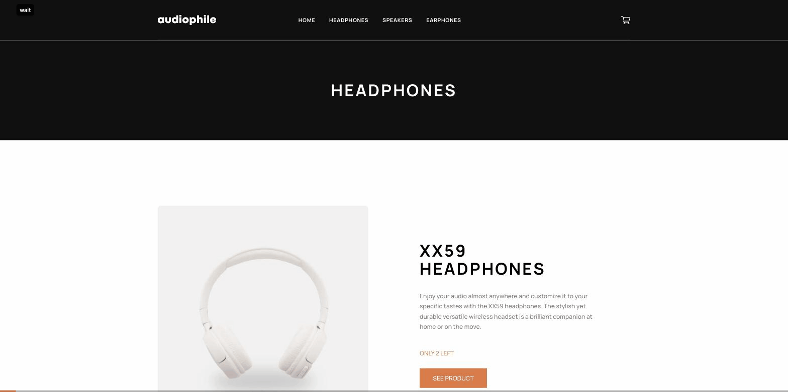

# audiophile

A headphone and speaker store with a real backend: stock that runs out, card payments verified on the server, and orders that can't be placed twice.

**[Try it →](https://audiophile-ochre.vercel.app/)** · Payments run in Paystack's test mode: no real money moves.



_Recorded on the live site: stock labels, the Add to Cart limit, the cart, and a Cash on Delivery order with made-up details._

---

## Where this came from

The design and product data come from the [Audiophile e-commerce challenge](https://www.frontendmentor.io/challenges/audiophile-ecommerce-website-C8cuSd_wx) on Frontend Mentor. The storefront pages (home, categories, products, checkout) follow that brief. Where the design's colours fell short of WCAG AA contrast, they were adjusted: a slightly deeper orange (`#B05C2B` instead of `#D87D4A`) and darker grey body text. The footer's placeholder social links were dropped.

The brief stops at the browser: a checkout form whose "Continue & Pay" shows a thank-you screen with nothing behind it. Built beyond it:

- **A database.** Products and stock live in Postgres. Pages are prerendered from it and refreshed when an order changes stock.
- **Real payments.** Cards go through Paystack (test mode), and the server verifies every payment with Paystack before an order exists. Cash on Delivery creates an order too.
- **Orders that hold up under pressure.** Two shoppers buying the last unit can't both get it, and a payment confirmed by the browser and by Paystack's webhook at once still makes one order. A payment that can't be fulfilled is refunded.
- **Stock you can see.** "Sold out" and "Only N left" on product and category pages. Add to Cart stops at what's in stock, counting what's already in your cart.
- **Tests and CI.** 204 tests, many against a real Postgres database and Paystack's test API, run on every push.

## Why full-stack here

My other two portfolio projects, [Listenprint](https://github.com/habibwritescode/listenprint) and [Pennywise](https://github.com/habibwritescode/penny-wise), are client-only on purpose. They handle one person's data, and keeping it on their device is the feature: no server, no account, nothing to delete later.

A shop is the opposite case, and that's why this one has a server:

- **Stock is shared.** The last unit belongs to whoever pays first, and only a database can decide that.
- **The browser can't be trusted with prices.** The cart in `localStorage` is a display copy. The server re-prices every line from the database before charging.
- **A payment needs a witness.** A popup saying "success" proves nothing. The server asks Paystack, and Paystack tells the server directly (the webhook) in case the shopper closed the tab.

Three projects, three deliberate answers to "where should this data live?"

## Try it

1. Add something to the cart. XX59 has 2 left, and XX99 Mark I is sold out.
2. Check out with any details. Use made-up ones: orders are stored (see [Limitations](#limitations)).
3. Pay either way:
   - **Card:** Paystack's popup opens in test mode. Use one of [Paystack's test cards](https://paystack.com/docs/payments/test-payments/).
   - **Cash on Delivery:** the order is placed straight away.

You get an order number (`AUD-000123`), and the product page shows the new stock on its next load.

**Why naira?** The Paystack account is Nigerian, and USD isn't enabled on it. Prices stay in dollars as the design shows, and card payments are charged in naira at a fixed demo rate of ₦1,600 per $1. The checkout shows the naira amount before you pay.

## Running it locally

Node is pinned in `.nvmrc` (22). You need Postgres 17; on macOS: `brew install postgresql@17 && brew services start postgresql@17`.

```bash
createdb audiophile && createdb audiophile_test
cp .env.example .env         # point DATABASE_URL at audiophile
cp .env.example .env.test    # point DATABASE_URL at audiophile_test
npm install                  # also generates the Prisma client
npm run db:migrate && npm run db:seed
npm run dev
```

Card payments need a Paystack **test** secret key (`sk_test_…`) in `PAYSTACK_SECRET_KEY`. Without one, Card is disabled and Cash on Delivery still works. Live keys are refused.

|                     |                                                                               |
| ------------------- | ----------------------------------------------------------------------------- |
| `npm run dev`       | Dev server (Turbopack)                                                        |
| `npm run build`     | Production build; type errors fail it                                         |
| `npm test`          | Vitest once; database tests use `.env.test`, Paystack tests need the test key |
| `npm run lint`      | ESLint, `--max-warnings=0`                                                    |
| `npm run typecheck` | `tsc --noEmit`                                                                |
| `npm run db:seed`   | Loads `lib/data.json`; idempotent, and never resets stock                     |
| `npm run db:reset`  | Drops and re-migrates the local database; refuses any non-local host          |

To see stock refresh after an order, use `npm run build && npm run start`. The dev server renders every request fresh, so it can't show it.

## Architecture decisions

### Postgres and Prisma, prerendered pages

Products, stock, orders and rate limits live in Postgres (Prisma 7; Neon on Vercel). Product and category pages are prerendered from the database at build time, so a page view reads no database.

Every deploy runs the migrations and the seed before the build. The seed upserts the product content from `lib/data.json` but only sets stock when a product is first created, so a deploy never undoes orders. Prisma can't express CHECK constraints, so `stock >= 0` and the order-amount rules are in hand-written migration SQL, as a backstop under the application checks.

### Paystack, not Stripe

The plan said Stripe. Stripe doesn't open accounts in Nigeria, so it's Paystack. The flow:

1. The server re-checks the cart, prices it and asks Paystack to start a transaction, with the amount and order id set server-side.
2. The browser opens Paystack's popup (loaded only when someone pays) for that transaction.
3. The server verifies status, currency and amount with Paystack before it places the order.

Two surprises from the account. USD returned "Currency not supported by merchant", hence naira. And Paystack has an undocumented amount ceiling: a test charge of ₦200M went through and ₦500M didn't. The checkout catches that rejection and says the order is too large to pay online.

### An order exists before the payment

When Paystack accepts a transaction, the server records a `PENDING_PAYMENT` order holding no stock. Only `fulfillCardPayment` turns it into `PLACED`. The browser calls it after the popup, "Check payment again" calls it, and Paystack's webhook calls it, often at the same moment.

It's idempotent because the claim is a conditional update: `PENDING_PAYMENT → PLACED` succeeds for exactly one caller, and the others find nothing to change. `paymentReference` is unique in the database, so one payment can never become two orders. If the browser loses its connection after paying, the checkout keeps the reference and only re-checks it. It never offers to pay again for the same cart.

The cost is a table of pending orders from abandoned checkouts. They're kept, not cleaned up.

### Stock under concurrency

Taking stock is `UPDATE … SET stock = stock - n WHERE id = … AND stock >= n`, in the same transaction as the order claim. If any line updates no row, the whole transaction rolls back. There's no read-then-write gap, and no stock count can go below zero.

Rows are locked in product-id order. Without that, two carts holding the same products in opposite orders can lock each other, and Postgres kills one of them with a deadlock error. A test runs those opposing carts against a real database. With the sort removed, it caught the deadlock in 5 of 5 runs.

### Paid but sold out: refunds

Stock isn't reserved while someone is in the popup, so the last unit can sell between the cart check and the payment. Then the order becomes `REFUND_PENDING` and the server asks Paystack for a full refund. The shopper is told the refund can take up to 10 business days.

A refund request is claimed before it's sent and released if Paystack refuses it, so it's retried and never sent twice. A claim older than 5 minutes is checked against Paystack's refund list, in case the server stopped mid-request. The webhook answers 500 until Paystack has accepted the refund, so Paystack keeps redelivering. A refund Paystack reports as failed is logged for a person to handle.

### Fresh stock on static pages

Pages show stock as of their last render. After an order takes stock, the server calls `revalidatePath` for that product's page and its category page, and Next.js regenerates them on the next request. Repeat confirmations and refunds don't.

The first version 404'd. The routes used `dynamicParams = false`, so unknown slugs never rendered. On a production build, Next.js 15.5 answered a revalidated page on such a route with a 404 (`NoFallbackError`): one order took the ZX7 page and the speakers category down. The dev server can't show this, so the check had to be a production build.

Both routes dropped the setting. Without it, every made-up URL would render a 404 cached for a year (and cost a query, for products). So `middleware.ts` turns unknown product slugs and category names away first. The trade-off is that the middleware now runs on every product and category view: a small cost per visit, instead of an unbounded one per made-up URL.

### The cart lives in the browser, and isn't trusted

The cart is a Zustand store persisted to `localStorage`. It loads after the first render so the server and browser HTML match. Stored lines are treated as untrusted input: malformed ones are dropped and carts are capped (20 products, 99 of each).

The real check is on the server. The cart modal and checkout both send the cart to `validateCart`, which returns current stock and prices in one query. A pure function, `reconcileCart`, turns those facts into corrections ("only 2 left, quantity updated"). An answer about a cart the shopper edited mid-check is thrown away.

### Rate limiting in Postgres

Starting a payment and placing a cash order are limited to 10 attempts per 10 minutes per IP. The counter is one upsert into a `RateLimit` table, so it holds across serverless instances without adding Redis.

The IP comes from `x-real-ip`, which Vercel sets and clients can't spoof there. On any other host, that assumption has to be checked.

## Testing and CI

204 tests across 18 files (measured at `962a56d`). GitHub Actions runs lint, migrations, the seed, the tests, the build and the type-check on every push and pull request, against a Postgres service container.

- **Order logic runs against a real database.** Concurrency bugs live in the database, and a mocked one would agree with whatever the code assumes. Race tests fire simultaneous fulfilments and opposing carts at the same rows.
- **Paystack's test API is called for real** when a test key is present: a transaction is created and verified end to end. A signed webhook is delivered to the real route against the test database.
- **Guards were proven by breaking them.** Each concurrency guard (the stock condition, the pending-only claim, the lock order, the refund retry, the stale-claim check) was removed in turn to confirm a test fails without it.
- **Test files run one at a time.** They share one test database, and a file that changes stock would otherwise break another's assertions mid-run.

Some things were checked by hand on a production build, because tests can't show them: stock refreshing after an order (three cash orders, each followed by a page load), and the 404s that led to the middleware.

## Limitations

- **Test mode only.** The code refuses live Paystack keys. Going live would first need the refund-claim fix below and a real review of the payment flow.
- **Order data is kept indefinitely.** Orders store the name, email, phone and address entered at checkout, with no retention policy or deletion. That's acceptable for a demo where everyone is asked to use made-up details, and not for real customers.
- **Stock isn't reserved during checkout.** Someone can pay for an item that sells out while they're in the popup. They're refunded automatically, but a real shop might hold stock for a few minutes instead.
- **Refund claims assume test-mode retry timing.** One timestamp marks both "refund being requested" and "refund accepted". Paystack retries webhooks hourly in test mode, longer than the 5-minute stale-claim window, so an interrupted request is always retried. Live mode retries every 3 minutes at first, so a crash at the wrong moment could stop the retries. Splitting the timestamp in two fixes it.
- **The rate limit trusts Vercel's `x-real-ip`.**
- **The catalog has two sources.** The middleware's product list is `lib/data.json` and the pages read the database. They agree because every deploy seeds every product in the file and never deletes one. A product added only to the database would 404, so products are added through `lib/data.json`.

## On AI-assisted development

<!-- DRAFT: written by Claude Code from what the build conversation shows. Confirm or rewrite this section. -->

This was built with Claude Code. What that did and didn't mean:

**Mine.** The scope and the bar: a written build spec asking for real persistence, real payments and a differentiator, at case-study standard. Switching to Paystack when Stripe wouldn't open a Nigerian account. Keeping payments in test mode. Approving each module's spec and plan before any code was written, and deciding which review findings got fixed. Where the tool proposed options, I chose among them.

**The tool's.** Most of the code and tests, the first draft of each spec and plan, and proposing most of the architecture above for me to approve or change. Repeated code reviews, which caught real problems: a refund that could be silently dropped, a deadlock between opposing carts, and the production-only 404s from revalidation.

## Credits

Design and product content: [Frontend Mentor](https://www.frontendmentor.io/challenges/audiophile-ecommerce-website-C8cuSd_wx). Typeface: [Manrope](https://fonts.google.com/specimen/Manrope). Payments: [Paystack](https://paystack.com) test mode.
